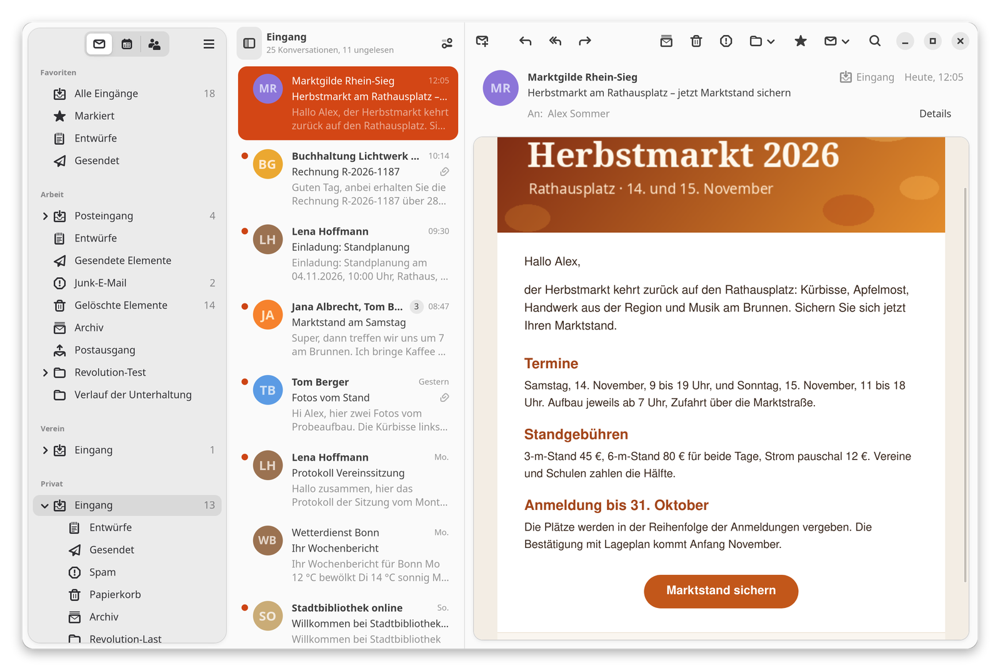
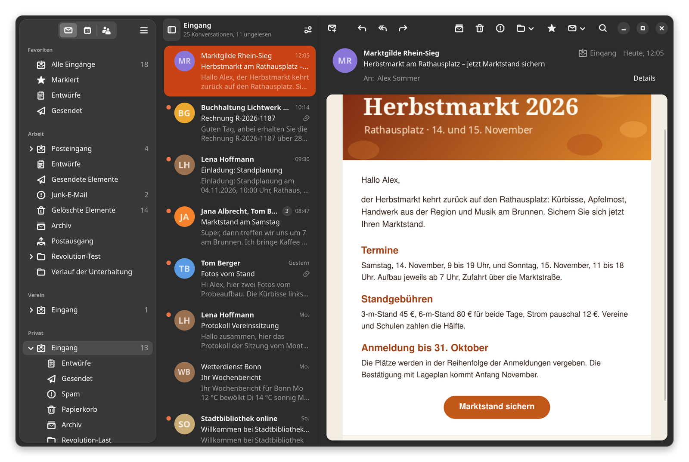

# Revolution

[Deutsch](README.de.md)

Modern mail client for GNOME with mail, contacts and calendar; the accounts come from GNOME Online Accounts.





## Status

| Milestone | Content | Status |
|---|---|---|
| M2 | Design | done |
| M3 | Scaffold | done |
| M4 | Reading mail | done |
| M5 | Handling mail | done |
| M6 | Contacts | open |
| M7 | Calendar | open |
| M8 | Release | open |

## Foundation

- Evolution-Data-Server 3.56 (Camel, libebook, libecal)
- GTK4 + libadwaita + Blueprint
- C

## Building (Ubuntu 26.04)

```sh
sudo apt install meson ninja-build blueprint-compiler gettext libgtk-4-dev libadwaita-1-dev \
  libcamel1.2-dev libedataserver1.2-dev libebook1.2-dev libwebkitgtk-6.0-dev \
  appstream desktop-file-utils libglib2.0-bin
meson setup build
meson compile -C build
GSETTINGS_SCHEMA_DIR=build/data ./build/src/revolution
```

`GSETTINGS_SCHEMA_DIR` points to the schema compiled in the build directory; after `meson install` it is no longer needed.

## Translations

Source strings are English; translations live in `po/` (German: `po/de.po`). Started from the build directory, the app uses the translations built there.

## Contributing

Build, tests, architecture and workflow: [docs/ENTWICKLUNG.md](docs/ENTWICKLUNG.md) (German).

## License

GPL-3.0-or-later, see [COPYING](COPYING). Copyright 2026 Arnd Messer.
